# overleaf-sync-now

> **Stops Claude Code and Codex CLI from silently overwriting your Overleaf web edits with a stale local Dropbox copy.**

[](https://github.com/hanlulong/overleaf-sync-now/actions/workflows/ci.yml)
[](LICENSE)
[](https://www.python.org/)
[](https://github.com/astral-sh/uv)

## The failure mode

You write a paper in Overleaf with Dropbox sync enabled. You edit on overleaf.com from another device, then come back to your laptop and ask Claude Code (or Codex CLI) to keep working on the paper. The AI agent reads the local `.tex` file — but Overleaf only pushes web edits to Dropbox **every 10–20 minutes**, so the local copy is stale. The AI proceeds to edit the stale file and saves it back, **silently overwriting your fresh web edits**. The tool call reports success. Paragraphs you wrote on the web vanish.

`overleaf-sync-now` is an **agent skill** (plus a CLI and PreToolUse hooks for Claude Code and Codex CLI) that closes this gap. Before every AI read or edit of a `.tex` / `.bib` / `.cls` / `.sty` / `.bst` file under `Apps/Overleaf/` (Read / Edit / Write, Bash or PowerShell commands, Codex `apply_patch`), it probes Overleaf's version history and pulls down anything new — without changing your existing Dropbox setup, so cross-device sync still works exactly as before.

### Is this for you?

- ✅ You write papers in Overleaf with **Dropbox sync** enabled (`Dropbox/Apps/Overleaf/<project>/`). Dropbox sync is a premium Overleaf feature: an individual or group subscription, or an institution in Overleaf Commons.
- ✅ You edit `.tex` files locally with **Claude Code** or **Codex CLI**
- ✅ You also edit on **overleaf.com** sometimes — from another device, in a browser, or with collaborators

If you only ever edit locally *or* only ever edit on the web, your local copy is never stale and you don't need this. Same if you don't use Dropbox or AI agents.

---

## Install

**Prerequisites**

- **git**, because the install command fetches the tool from GitHub. macOS: run `xcode-select --install` (or `brew install git`); on a fresh Mac, `git` is only a stub that offers to install the Command Line Tools. Windows: `winget install Git.Git`. Linux: your package manager's `git`.
- The **Dropbox desktop app**, with Overleaf's Dropbox sync turned on for your account.
- **uv**. The Manual install commands below install it; the agent prompt asks the agent to install it if it is missing.

In Claude Code or Codex CLI, paste this prompt:

```text
Install overleaf-sync-now v0.5.2 with `uv tool install --from git+https://github.com/hanlulong/overleaf-sync-now@v0.5.2 overleaf-sync-now` (install uv first from https://docs.astral.sh/uv/ if `uv` is missing), then run `overleaf-sync-now install`.
```

The agent installs everything and runs setup. **Restart the agent afterward** (`/exit` then `claude` in Claude Code; equivalent in Codex). In **Codex CLI**, also run `/hooks` once and trust the `overleaf-sync-now` hook: Codex skips new hooks until you do.

If install ends with **AUTH NOT YET CAPTURED** (on any OS), run `overleaf-sync-now login` yourself in a terminal: a browser opens (your installed Chrome or Edge; otherwise the tool downloads Chromium, about 300 MB) and you log into Overleaf there. This is also the fix on Windows with Chrome 127 or later and for Safari users on macOS, where reading the browser's own cookies doesn't work. [Details](docs/authentication.md). Never paste your Overleaf cookie into an AI chat.

*macOS: while `install`, `setup`, `status`, `doctor` or `sync` look for an existing Overleaf login in your browsers, macOS may ask for your login keychain password to let `security` read "Chrome Safe Storage" (or another browser's key). Choose **Allow** to use that login, or **Deny** and run `overleaf-sync-now login` instead. Avoid **Always Allow**: it adds the `security` tool to that key's access list, so any program that runs `security` can read the key later without a prompt. The tool reads each browser with up to two cookie readers, so the same dialog can appear twice for one browser; `sync` stops trying for an hour after a failure. The hook itself never touches the keychain.*

<details>
<summary><b>Manual install</b> (no AI agent)</summary>

**macOS / Linux:**
```bash
curl -LsSf https://astral.sh/uv/install.sh | sh && \
  export PATH="$HOME/.local/bin:$PATH" && \
  uv tool install --from git+https://github.com/hanlulong/overleaf-sync-now@v0.5.2 overleaf-sync-now && \
  overleaf-sync-now install
```

If uv says `~/.local/bin` is not on your PATH, run `uv tool update-shell` and open a new terminal. The hooks still work either way: `install` writes the CLI's full path into them.

**Windows (PowerShell):**
```powershell
powershell -ExecutionPolicy ByPass -c "irm https://astral.sh/uv/install.ps1 | iex"
$env:PATH = "$env:USERPROFILE\.local\bin;$env:PATH"
uv tool install --from git+https://github.com/hanlulong/overleaf-sync-now@v0.5.2 overleaf-sync-now
overleaf-sync-now install
```

</details>

**Upgrading from 0.4.x or earlier:** upgrade with the command in [docs/operations.md](docs/operations.md#upgrading), then re-run `overleaf-sync-now install` (it rewrites the Claude Code hook with the Bash/PowerShell matcher and an explicit timeout, and adds the Codex hook), and in Codex run `/hooks` and trust the entry. Until you re-run install, `overleaf-sync-now status` shows `Install: NEEDS ATTENTION`.

### Verify

After restart, edit any `.tex` file under `Dropbox/Apps/Overleaf/<project>/` — the hook fires automatically (in Codex, after you trust it with `/hooks`). Or check manually, from inside a project folder (or pass the folder):

```bash
cd ~/Dropbox/Apps/Overleaf/<project>   # macOS with a newer Dropbox: ~/Library/CloudStorage/Dropbox/Apps/Overleaf/<project>
overleaf-sync-now status   # cookie + linked project
overleaf-sync-now sync     # trigger a sync, print latency
```

---

## Why

You use Dropbox with Overleaf because it gives you **multi-device sync** — an edit on your laptop is instantly readable on your desktop and your iPad. (Overleaf's Dropbox sync is a premium feature, and Dropbox does not let the `Apps/Overleaf` folder be shared, so your collaborators don't get your copy; to sync to their own Dropbox they need their own premium subscription.) AI agents like Claude Code and Codex CLI plug into that setup naturally: they just read and write the local `.tex` file like you do.

The problem: Overleaf's Dropbox sync polls the **Overleaf-web → local** direction every 10–20 minutes. So if you've edited the paper on overleaf.com and then ask the AI to keep working, it reads a stale local file and silently overwrites the changes you just made — restoring deleted paragraphs, undoing fresh edits, all while reporting a successful tool call.

`overleaf-sync-now` checks Overleaf for fresh content immediately before each AI edit and pulls only what changed. Dropbox keeps doing its multi-device job; the AI loop stops clobbering your work. Nothing else in your setup changes.

| Sync direction | Stock Overleaf + Dropbox | With `overleaf-sync-now` |
|---|---|---|
| Local edit → Overleaf | a few seconds | a few seconds *(unchanged)* |
| **Overleaf web edit → local Dropbox** | **10–20 minutes** (next poll) | **~1 s probe; ~5–10 s if a real change must be pulled** |
| AI agent reads a stale local file | yes, often | **no** |

When nothing changed on the Overleaf side, the hot path is ~0.3–1 s (a single read-only probe, plus a quick cookie check (`GET /project`) when the last check is more than 60 s old; no zip download). When something changed, the tool downloads the project zip once and writes only the files whose content differs from local — typically 5–10 s for a normal paper.

---

## How it works

<p align="center">
  
</p>

1. The **PreToolUse hook** runs before every Claude Code `Read` / `Edit` / `Write` / `Bash` / `PowerShell` call and every Codex CLI `apply_patch` / `Bash` call that touches a `.tex` / `.bib` / `.cls` / `.sty` / `.bst` file. Shell commands are scanned for LaTeX paths; Codex patches are parsed for the files they change. Other tools and other file types pass through.
2. **Auto-link** maps `…/Apps/Overleaf/<name>/` to its Overleaf project ID via a 24-hour-cached project list. On a unique match the tool drops a tiny `.overleaf-project` marker into the folder so future resolution is deterministic — no manual setup needed. Override or pre-seed it with `overleaf-sync-now link <id>` when names differ or two projects share a name.
3. **Resolver safety net** (since 0.3.0): the cached project list keeps trashed/archived flags, lastUpdated, and ownerId. Trashed and archived projects are filtered out of auto-link, and if two living projects still share a name the tool refuses to guess — it lists the candidates and asks you to pick. A sync-time fingerprint check warns if the linked project's recent Dropbox-origin updates touch files not present locally (the "I linked the wrong project" smoke detector).
4. **Version-match probe**: `GET /project/<id>/updates` returns Overleaf's history (`fromV` / `toV` / changed pathnames / origin). The tool caches the latest `toV` per project.
   - Latest `toV` matches cached → skip, no download.
   - Updates exist but are all Dropbox-origin (echoes of our own local saves round-tripping through Dropbox) → skip, no download.
   - A web-origin update exists → `GET /project/<id>/download/zip` and extract only the changed pathnames (including files added or renamed on the web), hash-compared so unchanged files aren't rewritten.
5. **Data-safety guards**: extraction never overwrites a local file modified in the last 30 seconds — protects an in-progress local save that hasn't yet propagated Dropbox → Overleaf (override with `sync --force`). Before any overwrite, the previous local version is copied to `<DATA_DIR>/backups/<project>/<timestamp>/` (kept 30 days). On a first sync, or after a long gap when the whole project is compared, a local file that was changed after Overleaf's last change to it (edits Overleaf never received, e.g. while Dropbox was paused) is kept, and Overleaf's version goes to `<DATA_DIR>/conflicts/<project>/<timestamp>/`; the first AI write to that file is then blocked once so the agent asks you which version to keep. Whenever a refresh writes, keeps or skips files, the hook reports it in one line: Claude Code and Codex show it to you and pass it to the agent (as the hook's `systemMessage` and `additionalContext`).
6. **Debounce**: reads share one probe per project per 30 s; writes probe again after 3 s, so a web edit made between the agent's read and its edit is still caught.
7. **Fail closed on writes** (since 0.5.0): the hook blocks a write (exit 2, with the reason shown to the agent) when it can't tell which Overleaf project the folder is (not logged in, no project with that name, or several), when the refresh just pulled newer content into the file being edited (the agent must re-read first), when the file changed on the web but was also saved locally in the last 30 s (a conflict the refresh can't resolve), or when the file was deleted or renamed on overleaf.com (deleting the outdated local copy is still allowed). Reads are never blocked. A blocked write is probed again on retry (the 3 s debounce is cleared), so the next edit in the same turn cannot slip through. Network failures (offline, or no network access) and rate limits never block: the call proceeds with a note that says Overleaf could not be reached, which is not reported as a login problem. A folder under `Apps/Overleaf/` that is not an Overleaf project can be opted out with an empty `.overleaf-sync-ignore` file in it. That file syncs to Overleaf like any other, so it never overrides a linked folder or a folder whose name matches a project; to opt out a real project, list its folder in `OVERLEAF_SYNC_IGNORE` instead.

For deeper details, see [`docs/architecture.md`](docs/architecture.md).

---

## Known limitations

- **A web edit made while the agent is mid-edit can still be lost.** The hook runs just before each tool call. If someone edits the same file on overleaf.com after that probe (while the model is writing its change), the hook cannot see it. The agent's write replaces the whole file, Dropbox uploads it, and the web edit is overwritten: last writer wins, nothing is merged. Version 0.5.0 narrows this window: every write probes again (unless the project was probed in the last 3 s), and if that probe pulls new content into the file being edited, the write is blocked until the agent re-reads the file. The gap between that final probe and the write itself remains. Avoid editing a file on the web while an agent is editing it. If it happens, the overwritten text is still in the project's History on overleaf.com. [Issue #2](https://github.com/hanlulong/overleaf-sync-now/issues/2) describes this failure mode in detail.
- **Shell commands are scanned, not understood.** The hook sees LaTeX paths written in a Bash or PowerShell command (including quoted paths, `cd <dir> && …` with environment variables such as `$HOME` or `$env:USERPROFILE`, and `*.tex` globs). Paths built at run time (a variable set in the same command, `find -exec`, a script that opens files itself) are invisible to it. Telling read-only commands from writes is a heuristic; unknown programs count as writes.
- **Web-side deletes and renames are not mirrored locally.** The tool never deletes local files. A file deleted or renamed on overleaf.com stays on disk until Dropbox removes it; until then, AI edits to it are blocked (deleting it is allowed) and reads get a note.
- **The `.overleaf-project` marker syncs into your Overleaf project.** Auto-link writes this small JSON file (the project id and when it was linked) into the project folder, so Dropbox uploads it and collaborators can see it. It holds no credentials. `overleaf-sync-now uninstall` lists the markers it finds and removes them with `--remove-markers`.
- **No network, no refresh.** Offline, the hook cannot check Overleaf and lets the call through with a note, so the local copy may be stale. In Codex CLI's default sandbox the hook itself still runs with network access (Codex runs hooks outside the sandbox), but an `overleaf-sync-now sync` that the agent runs is sandboxed: approve it with network access, or run it from a normal terminal.
- **Codex CLI needs one manual step.** Codex skips new or changed hooks until you trust them with `/hooks`. The Windows variant of the Codex hook (`commandWindows`) is untested.
- **A hook that fails to start or times out does not block the tool call** (the Claude Code and Codex default). In Claude Code 2.1.295 or later you can add `"onFailure": "block"` to the hook entry in `~/.claude/settings.json` to make such failures block instead; `install` keeps that setting when it rewrites the entry.
- **overleaf.com only.** Self-hosted Overleaf / Server Pro is not supported.

---

## Subcommands

```
overleaf-sync-now --version                              # print package version
overleaf-sync-now install                                # one-shot setup (idempotent)
overleaf-sync-now login                                  # browser-assisted login (the recommended auth path, any OS)
overleaf-sync-now setup                                  # auth wizard (auto-detect from existing browsers)
overleaf-sync-now save-cookie                            # headless only: type the cookie at a hidden prompt yourself
overleaf-sync-now sync [folder] [--force] [--wait]       # refresh against Overleaf; --force re-extracts; --wait lets fresh local saves age out first
overleaf-sync-now status [folder] [--quick]              # cookie validity + linked project (source, name, trashed/archived flags, lastUpdated, cached toV)
overleaf-sync-now projects [--refresh]                   # list projects with NAME | PROJECT_ID | FLAGS (T/A/DUP) | LAST_UPDATED, sorted by recency
overleaf-sync-now doctor [folder]                        # full diagnostic, including a /updates probe
overleaf-sync-now link <id> .                            # override auto-link with a marker file (warns if id is trashed/archived)
overleaf-sync-now uninstall [--remove-markers] [FOLDER...]  # remove skill + hooks, list what's left (markers, cookies, backups, browser)
```

`sync` and `status` default to the current directory. Run `overleaf-sync-now --help` for full usage. `install` and `uninstall` follow `CLAUDE_CONFIG_DIR` and `CODEX_HOME` when you keep the Claude Code or Codex configuration somewhere other than `~/.claude` / `~/.codex`.

---

## Documentation

| Topic | Where |
|---|---|
| **Authentication** — auth chain, Chrome 127+ ABE, manual paste fallback | [`docs/authentication.md`](docs/authentication.md) |
| **Architecture** — files written, hook internals, exit codes, latency budget, reverse-engineering | [`docs/architecture.md`](docs/architecture.md) |
| **Operations** — cookie maintenance, rate limits, upgrading, uninstalling, multi-account | [`docs/operations.md`](docs/operations.md) |
| **Troubleshooting** — common errors and fixes, diagnostic commands | [`docs/troubleshooting.md`](docs/troubleshooting.md) |
| **Contributing** — local setup, style, areas needing help | [`CONTRIBUTING.md`](CONTRIBUTING.md) |

---

## Related projects

The Overleaf-AI integration space is crowded. Each of these solves a different slice of the problem:

| Tool | Keeps Dropbox? | Fires automatically before AI edits? | Solves the stale-file failure mode? |
|---|---|---|---|
| **`overleaf-sync-now`** *(this repo)* | ✅ keeps it | ✅ Claude Code and Codex CLI PreToolUse hooks | ✅ |
| [`aloth/overleaf-skill`](https://github.com/aloth/overleaf-skill) (npm `@aloth/olcli`) | ❌ replaces it | ❌ manual `olcli sync` | partial — only when user remembers |
| [`overleaf-sync` (olsync)](https://github.com/moritzgloeckl/overleaf-sync) | ❌ replaces it | ❌ manual `olsync download` | partial — same as above |
| [Overleaf Git integration](https://www.overleaf.com/learn/how-to/Using_Git_and_GitHub) (Premium) | ❌ replaces it | ❌ manual `git pull` | partial — same as above |
| [Overleaf Workshop (VS Code)](https://github.com/overleaf-workshop/Overleaf-Workshop) | ❌ no Dropbox | ❌ different model (live WebSocket) | n/a — you're not editing local files |
| MCP servers ([OverleafMCP](https://github.com/mjyoo2/OverleafMCP), [overleaf-claude-mcp](https://github.com/Junfei-Z/overleaf-claude-mcp), [Overleaf-mcp](https://github.com/GhoshSrinjoy/Overleaf-mcp), [overleafMCP-rw](https://github.com/hiufungleung/overleafMCP-rw)) | ❌ go via Git | ❌ Claude calls a tool | n/a — different model |
| [`pyoverleaf`](https://github.com/jkulhanek/pyoverleaf) | n/a | n/a | a library, not a product |

`overleaf-sync-now` is the only tool that **keeps Dropbox** (so all your devices and collaborators stay in sync the way they already do) **and fires automatically** (so the AI agent loop never reads a stale file). Smaller, narrower, invisible.

---

## License

[MIT](LICENSE)

overleaf-sync-now is an independent, unofficial tool. It is not affiliated with or endorsed by Overleaf or Dropbox, and it relies on overleaf.com endpoints that are not a public API and can change without notice.

## Credits

Created by **[Lu Han](https://luhan.io/)**. Published by **[OpenEcon.ai](https://openecon.ai/)**.

If this saved you time, a ⭐ on the repo helps other researchers find it.
